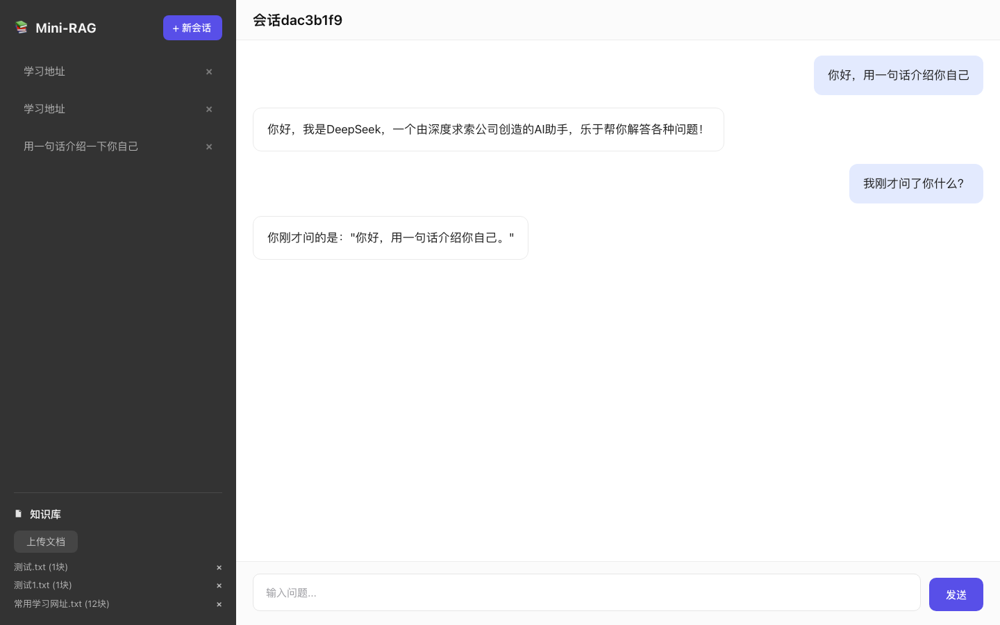

# Mini-RAG · 本地知识库问答

> 文档版本：`2026.11.10` · 最近更新：2026-11-10
>
<!-- > README 使用日期版本号 `YYYY.MM.DD`。每次更新文档时，在下方“版本更新记录”顶部新增一条记录，并同步更新文档版本和最近更新日期。此版本号仅管理文档变更，不代表应用程序发布版本。 -->

## 项目简介

基于 **Flask + DeepSeek** 的轻量 RAG（检索增强生成）问答系统：上传文档 → 文本解析与切块 → TF-IDF 向量化 → 相似度检索 → 拼装上下文 → 流式回答。前端使用 HTML、CSS 和 JavaScript，无框架依赖。




## 版本更新记录

### `2026.11.10` — 2026-11-10

- **密钥与访问**：支持在页面登录并输入 DeepSeek API Key；密钥只保存在当前浏览器会话，可在页面编辑或删除。未配置密钥时仅开放本地知识库检索，不调用模型生成回答。
- **流式控制**：生成时可随时停止；默认最多显示配置指定的字符数，也可切换完整显示。会话保存完整回答。
- **回答模式**：通过按钮单选知识库问答或 DeepSeek 通用回答；普通检索也会显示片段数和分析进度，DeepSeek 通用回答默认完整显示且锁定此选项。切换模式时重置全文检索和完整显示选项；首次上传知识库文档后自动切回知识库问答。
- **移动端与页面布局**：新增移动端侧栏菜单和响应式聊天输入区；回答方式使用按钮式单选，适配不同手机宽度。左侧知识库区域高度不超过视口的 45%，上传状态列表最高 120px 并支持滚动。
- **文件操作反馈**：上传支持排队追加，重复文件直接跳过并提示；完整显示上传中和排队中文件，队列列表最高 120px 并支持滚动，全部完成后收起状态列表，失败时保留错误提示。删除处理中显示进度并禁用重复操作，成功后收起提示，失败时显示错误。

### `2026.11.04` — 2026-11-04

- **检索与回答**：按文档大小选择切块和 Top K；全文检索由用户勾选，默认关闭，开启后对命中的相关文档分批分析全部片段。
- **飞机手册问答**：回答汇总参考资料中涉及的 MSN、问题描述、ECAM 警告、MEL 项目及相关条件。
- **文档格式**：支持 PDF 文本与表格、Word `.docx` / `.doc`、Excel `.xlsx` / `.xls`、CSV、Markdown 和 TXT；扫描版 PDF 暂不支持 OCR。
- **删除与上传**：删除文件或会话前增加确认；文件按文档 ID 精确删除；阻止同名同类型文件重复上传。
- **会话体验**：刷新后自动打开最近更新的真实会话；移除页面内置示例对话，有内容时隐藏新会话空状态提示。
- **输入体验**：问题输入框按 Enter 换行，点击“发送”才提交。

## 功能特性

- 支持 PDF、Word、Excel、CSV、Markdown 和 TXT 文档。
- PDF 表格通过 `pdfplumber` 提取；Word 和 Excel 中的表格按行转换为文本。
- 扫描 PDF 不支持 OCR；遇到无可提取文本的页面时会提示用户核对原文。
- 全文检索由用户主动勾选，默认关闭；开启后，命中相关文档时会分批分析该文档的全部片段，避免一次性提交过长上下文。
- 未使用全文检索时，根据文档大小选择 Top K；大文档和小文档分别应用各自参数。
- 手册问答按参考资料整理 MSN / MSN 范围、问题描述、ECAM 警告、MEL 项目和放行条件；资料未标明的适用范围会单独提示。
- 相同文件名和类型的文档不能重复上传；如需替换，请先删除已有文件。
- 重复文件在上传前拦截；若服务端检测到重复，也会跳过上传并提示，不会作为失败项显示。
- 多文件上传支持排队和继续追加；所有排队文件都会显示，状态列表最高 120px 并可滚动。全部完成后收起状态列表，失败项保留错误提示。
- 删除文件或会话前会询问确认；删除文档按唯一 ID 执行，不会删除其他文档。
- 文档删除时显示进行中提示并暂时禁用删除操作；完成后刷新文档列表，失败时显示错误并允许重试。
- 多会话管理、JSON 持久化、SSE 流式回答。
- 可从页面配置 DeepSeek API Key；未登录时只能使用本地知识库检索。用户输入的密钥存于浏览器 `sessionStorage`，关闭浏览器标签页会清除。
- 默认最多在页面显示 4000 字符，完整回答仍会保存在会话中；可在输入区勾选“完整显示回复”。
- DeepSeek 通用回答默认完整显示，且“完整显示回复”选项固定选中并禁用；在知识库问答模式下该选项可切换。切换回答方式会清除全文检索勾选，并将完整显示重置为当前模式的默认值。
- 普通检索和全文检索都会显示检索片段数与分析批次进度；普通检索以单批次发送给模型。
- 生成过程中点击“停止”会中断浏览器连接，并关闭服务端的上游流式响应。
- 移动端采用按钮式回答模式单选，避免原生下拉框在不同手机上的显示差异；左侧知识库区域最高为视口高度的 45%，超出内容可滚动。

## 检索说明

1. 已配置 DeepSeek API Key 时，用户可选择“知识库问答”或“DeepSeek 通用回答”；没有密钥时只能使用本地知识库检索。
2. 知识库问答默认使用相似度检索；勾选“全文检索”后，系统会查找包含问题关联词的文档，并将命中文档的全部片段分批交给模型归纳。
3. 默认情况下，系统按每份文档的提取文本长度判断大小，并分别选择大文档或小文档的 Top K。
4. 配置密钥后，检索和归纳结果连同对话历史交给模型，回答以 SSE 方式返回；没有密钥时直接返回本地检索片段。

全文检索会增加处理时间和模型调用量。手册检索结果仅供查阅；涉及维修或放行时，请核对手册原文和具体条目，不要仅凭检索结果作决定。

## 快速开始

要求：Python 3.9+

```bash
git clone https://github.com/gaodaxiu0406/Mini-Rag.git
cd mini-rag

python3 -m venv .venv
source .venv/bin/activate        # Windows: .venv\Scripts\activate

pip install -r requirements.txt
cp .env.example .env
```

如需模型生成回答，可在页面登录时输入 DeepSeek API Key，或在 `.env` 中配置 `DEEPSEEK_API_KEY`。留空时仍可上传文档并使用本地知识库检索。然后启动：

```bash
python app.py
```

默认访问地址为 <http://localhost:8000>。首次启动会自动创建 `data/` 目录。

应用不会预置默认会话或默认会话详情。首次进入时会话列表可能为空；点击“新会话”或发送首个问题后，系统才会创建会话并生成详情数据。刷新页面时会自动打开最近更新的真实会话；没有历史会话时显示空状态，不展示示例对话。会话列表按最近更新时间排序。查询不存在的会话 ID 时，`GET /api/sessions/{id}` 返回 `404`。

### 文件格式补充

- 旧版 Word `.doc`：macOS 使用系统 `textutil`；其他系统需要安装 LibreOffice 或 Antiword。
- PDF 表格：使用 `pdfplumber` 提取。复杂版式的表格仍可能需要人工核对。
- 扫描 PDF：本项目目前不提供 OCR。若解析后列表或文字缺失，请提供相关页面或样例文件以便定位。

## 配置项

项目读取 `.env` 中的同名配置；未设置时使用表中默认值。`.env.example` 提供一组可直接起步的参数。

| 配置项 | `config.py` 默认值 | 说明 |
|---|---:|---|
| `DEEPSEEK_API_KEY` | 空 | 可选；配置后可使用 DeepSeek 生成回答；也可在页面登录时输入 |
| `DEEPSEEK_BASE_URL` | `https://api.deepseek.com` | OpenAI 兼容接口地址 |
| `DEEPSEEK_MODEL` | 空 | DeepSeek 模型名称 |
| `DEEPSEEK_TEMPERATURE` | `0.7` | 生成温度 |
| `DEEPSEEK_MAX_TOKENS` | `2048` | 最终回答的 token 上限 |
| `CHAT_DISPLAY_MAX_CHARS` | `4000` | 页面默认显示的回答字符数上限；勾选“完整显示回复”可绕过页面显示限制 |
| `LARGE_DOCUMENT_THRESHOLD` | `100000` | 大文档阈值，按提取文本字符数计算 |
| `CHUNK_SIZE` | `1200` | 大文档切块长度 |
| `CHUNK_OVERLAP` | `300` | 大文档相邻块重叠长度 |
| `RETRIEVAL_TOP_K` | `20` | 普通检索时每份大文档最多召回片段数 |
| `SMALL_CHUNK_SIZE` | `400` | 小文档切块长度 |
| `SMALL_CHUNK_OVERLAP` | `100` | 小文档相邻块重叠长度 |
| `SMALL_RETRIEVAL_TOP_K` | `4` | 普通检索时每份小文档最多召回片段数 |
| `RETRIEVAL_BATCH_CHARS` | `20000` | 全文检索分批归纳时的批次字符上限 |
| `RETRIEVAL_BATCH_MAX_TOKENS` | `1200` | 每批归纳输出 token 上限 |

上传文档时根据提取文本长度选择对应 chunk 参数。修改切块参数不会自动重切已有索引；需要删除后重新上传文档，才能应用新的切块设置。

## API

| 方法 | 路径 | 说明 |
|---|---|---|
| `GET` | `/api/sessions` | 按时间倒序列出会话 |
| `GET` | `/api/app-config` | 返回服务端是否配置 DeepSeek Key 及页面回答显示上限 |
| `POST` | `/api/sessions` | 新建会话 |
| `GET` | `/api/sessions/{id}` | 获取已存在会话及历史消息；会话不存在时返回 `404`，不会返回默认会话数据 |
| `DELETE` | `/api/sessions/{id}` | 删除指定会话 |
| `POST` | `/api/chat/stream` | SSE 流式对话 |
| `GET` | `/api/documents` | 列出已入库文档（含文档 ID） |
| `POST` | `/api/documents/upload` | 上传文档，表单字段为 `file` |
| `DELETE` | `/api/documents/{doc_id}` | 按文档 ID 删除该文档及其片段 |

`POST /api/chat/stream` JSON 字段：

| 字段 | 类型 | 默认值 | 说明 |
|---|---|---|---|
| `message` | string | 必填 | 用户问题 |
| `session_id` | string | 空 | 会话 ID；省略时自动创建 |
| `use_knowledge_base` | boolean | `true` | 是否使用知识库 |
| `full_document_search` | boolean | `false` | 是否检索命中文档的全部片段 |

浏览器登录密钥通过 `X-DeepSeek-API-Key` 请求头发送至聊天接口，不写入会话记录或服务端配置文件。若服务端 `.env` 已配置 `DEEPSEEK_API_KEY`，该密钥可作为默认密钥使用。

SSE 事件格式示例：

```text
data: {"type":"meta","retrieved_count":4}
data: {"type":"progress","text":"正在分批分析片段。"}
data: {"type":"content","text":"根据资料，"}
data: {"type":"error","message":"..."}
data: [DONE]
```

## 项目结构

```text
mini-rag/
├── app.py                 # Flask 路由、聊天与文档上传
├── config.py              # 环境变量配置
├── document_parser.py     # PDF、Office、CSV、Markdown、TXT 解析
├── llm.py                 # DeepSeek / OpenAI 兼容客户端
├── rag.py                 # 切块、向量化和检索
├── storage.py             # 文档与会话 JSON 持久化
├── requirements.txt
├── .env.example
├── static/
│   ├── index.html
│   ├── css/style.css
│   └── js/app.js
└── data/                  # 运行时数据，不应提交到版本库
    ├── docstore.json
    ├── vectorizer.pkl
    └── sessions/
```

## 设计说明与限制

- 使用 TF-IDF 字符 n-gram 检索，不依赖向量数据库或 GPU；语义改写、同义词召回能力有限。
- 全文检索按问题关联词定位文档，再处理命中文档的全部片段；模型归纳仍可能受上下文和生成能力影响。
- PDF 表格识别依赖版式和表格线索，复杂表格、跨页表格或扫描页面可能无法完整还原。
- `.doc` 解析依赖本机转换程序；当前平台没有可用转换程序时，接口会提示安装依赖或另存为 `.docx`。
- 知识库使用 JSON 文件存储，适合本地个人使用；暂不适用于高并发或多用户部署。

## License

MIT
